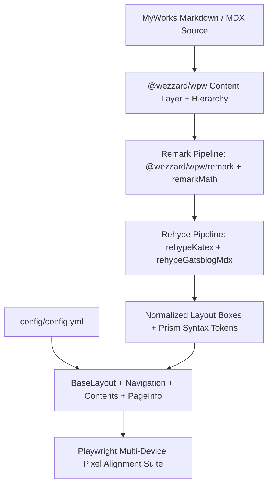

# Visual Parity and Layout Architecture

This document specifies the layout invariants, responsive breakpoints, typographic box normalization, and MDX AST transformation rules required to maintain pixel-level parity with the reference deployment at `https://wezzard.com`.

## `VP-1`: Deterministic Rendering Environment and Web Fonts

- The Astro development toolbar must remain disabled (`devToolbar: { enabled: false }`) so that no diagnostic overlay obscures viewport rendering during development or visual regression testing.
- The document head must load `Roboto` (`300`, `300i`, `400`, `400i`, `500`, `500i`), `Roboto Mono` (`300`, `300i`, `400`, `400i`, `500`, `500i`), and `Gentium Book Basic` (`400`, `400i`, `700`, `700i`) so that sans-serif, monospaced, and serif fallback metrics match the reference deployment.

## `VP-2`: Application Shell, Responsive Breakpoints, and Page Footer

- The root `html` element must set `font-size: 62.5%` (`1rem = 10px`) and `font-weight: 300` using `--font-ui-sans`.
- The layout must enforce two primary viewport breakpoints: `--bp-small-screen` at `max-width: 1440px` and `--bp-mobile` at `max-width: 960px`.
- At viewports wider than `1440px`, the content column must use `box-sizing: content-box`, `padding-left: 30%`, `width: 61.8%`, and `max-width: 780px`, with `5.5rem` horizontal inner padding.
- At viewports between `961px` and `1440px`, the content column must expand to `width: 70%` with `max-width: none`.
- At viewports of `960px` or narrower, the content column must span `width: 100%` with `padding-top: 44px` and `2.1rem` horizontal inner padding, followed by the mobile `SiteFooter` pane (`margin: 5.5rem 2.1rem`).
- Every content-layout page must wrap its primary sections inside the `Contents` container, insert a `1px solid #e3e3e3` `ContentSeparator` between multiple sections (such as between a post article and `MorePosts`) and before the bottom footer, and render `PageInfo` (`padding: 5.5rem 0`) displaying `site.footerMessages` and the build attribution line.
- The `404` error page must use the `Error` layout (`center` full-bleed background, centered `61.8%`-height wrapper, black `5.5rem`-padded monospaced uppercase card on desktop, and translucent blurred card on mobile).

## `VP-3`: Navigation Sidebar, Table of Contents, and Mobile Drawers

- `NavigationBar` must render `Home` (`/`) followed only by configured category items (when enabled) and `customNavigationItems` (`Profile`), without injecting a `Tags` item into the primary navigation list.
- On desktop viewports (`> 960px`), every `NavigationBar` link must render a `0.3rem × 2.1rem` right-hand vertical bar (`::after`) colored `#ffffff` for unselected items and `#8c8c8c` for the selected item.
- `TableOfContents` must compute hierarchical section numbers (`1`, `1.1`, `2`, and so on) with common-prefix shifting, generate `#kebabSlug` section links matching `lodash.kebabCase`, apply five-decimal unitless `line-height` ratios (`1.16667` on `.toc-title`, `1.72727` on desktop `.toc-anchor`, and `1.93333` on mobile `.toc-anchor`) with golden-ratio item paddings (`2.1012rem` top and `1.2988rem` bottom), render within a `max-width: 396px` black blurred panel on viewports above `1440px`, and expand with `margin-left: -5.5rem` between `961px` and `1440px`.
- On mobile viewports (`<= 960px`), the fixed `44px` top bar and full-screen `100vh` open drawer must apply `backdrop-filter: saturate(180%) blur(20px)` over `rgba(0, 0, 0, 0.7)`.
- Opening the mobile navigation drawer must rotate the two-bar burger icon into a `45deg` cross, fade out the site title and table-of-contents toggle button, reveal full-width bordered navigation items starting immediately below the `44px` header, and display the full-width `SocialBar` row below the navigation list.
- Opening the mobile table-of-contents drawer must animate the `<>` arrow icon, fade out the site title and burger button, and reveal the centered `TABLE OF CONTENTS` header and scrollable section list (`width: auto`) with zero `transition-delay` on `.toc-section` items.

## `VP-4`: Templates, Metadata, Pagination, License, and Taxonomies

- All four content templates (`Index`, `Page`, `Post`, and `Taxonomies`) must apply `margin-top: 5.5rem` on desktop viewports and `margin-top: 2.1rem` on mobile viewports (`<= 960px`).
- `Page` and `Post` headers must apply `margin-bottom: 5.5rem` with `.metadata { margin-top: 2.1rem }`, `.main { margin-bottom: 5.5rem }` resetting first/last child outer margins, and `.footer { margin-bottom: 5.5rem }` on posts.
- `PostExcerpt` must extract plain-text summaries by traversing parsed Remark MDAST `text` and `inlineCode` nodes (excluding frontmatter and `footnoteDefinition` subtrees), prune summaries at word boundaries up to `300` characters using `underscore.string` semantics, wrap the summary text in a link to the post slug, render titles as `2.4em` `h1` elements (`line-height: 1.41667`), and render `MDXMetadata` rows separated by `2.1rem`.
- `MDXMetadata` must render `TimeLabel` (`line-height: 1.18182`), `Bullet` separators (`•`), and `Taxonomy` items (`line-height: 1.90909; margin: -0.6rem 0 -0.7rem 0`) with a `0.1rem × 0.8rem` vertical divider bar (`margin: 0 0.5rem`), using five-decimal unitless `line-height` ratios that match PostCSS `postcss-calc` pre-evaluation.
- `Paginator` must always render `{pageNumber} / {pagesCount}`, placing `< {previousPageTitle}` on the left when `pageIndex > 0` and `{nextPageTitle} >` on the right when `pageIndex + 1 < pagesCount`, and must apply `font-size: 1.1em; line-height: 1.18; margin: -0.2rem 0 -0.3rem 0` on both `span` and `a::before` / `a::after` pseudo-elements.
- `PostFooter` must render post tags (`margin-bottom: 5.5rem`) and `License` without a top border, wrapping the `88×32` Creative Commons 4.0 badge inside an `inline-block` (`overflow: hidden; width: 88px; height: 32px`) child of `.license-image` to preserve the `2.50px` inline baseline descender alongside uppercase monospaced license text (stacking text above badge on mobile viewports).
- `MorePosts` must render `Later Post` and `Earlier Post` side-by-side in a two-column flex row on desktop (`min-width: calc(50% - 3.4rem); margin-right: 3.4rem`), stack vertically on mobile viewports, and apply `display: flex; flex-direction: column; align-items: stretch` on `.more-title` and `.more-subtitle` so negative heading margins do not collapse across sibling blocks.
- `TaxonomySummary` on `/tag` must render `[ {tagName} ]` (`1.7em`), up to `5` bulleted post links (`margin-bottom: 3.4rem`, `font-weight: 200`), and an uppercase `MORE ...` link, with `margin-bottom: 5.5rem` between summaries.

## `VP-5`: Normalized MDX Layout Boxes and Build-Time AST Transformation

- A build-time Rehype plugin (`src/lib/rehype-gatsblog-mdx.mjs`) must normalize compiled Markdown and MDX elements into the exact cap-height-trimmed layout boxes used by the reference system:
  - Headings `h1` through `h6` must render `<hN id="__heading_{kebabSlug}" class="mdx-h">...</hN>` with negative margin compensation around `3.4rem` vertical anchor padding (`2.1rem + 44px` top padding on mobile), ensuring that Astro's `rehypeHeadingIds` pass does not inject a duplicate `#{kebabSlug}` anchor target onto `<hN>` ahead of the padded ``.
  - Standalone images and linked images inside paragraphs must render inside `.mdx-geometry` (`margin: 0 -2.1rem 3.4rem -2.1rem`) with `loading="eager"` and `decoding="sync"`, wrapping titled images in `<figure class="mdx-figure">...<figcaption class="mdx-figcaption">{title}</figcaption></figure>` and scaling `@2x`/`@3x` image sets to their `1x` presentation dimensions capped at `712px` width.
  - Text paragraphs must wrap `
` (`line-height: 1.70588` with `-1.1rem / -1rem` vertical trim for serif, or `line-height: 1.93333` with `-1.2rem / -0.9rem` vertical trim for sans-serif) inside `.mdx-p-wrap` (`margin-bottom: 3.4rem`).
  - Fenced code blocks must tokenize via PrismJS using the legacy token palette, render optional `path` headers and colored language badges (`swift`, `objectiveC`, `python`, `sh`, and others), and render a CSS-counter `.mdx-line-numbers` gutter inside `.mdx-code-block` (`margin: 0 -2.1rem 3.4rem -2.1rem`).
  - Unordered, ordered, and task lists must render flex-row list items (`margin-bottom: 3.4rem`) with custom `::before` bullets (`\2022`) or hierarchical `counters(ordered-list, '.')` markers.
  - Blockquotes (`3px solid #141414`, `padding: 2.1rem 0 2.1rem 3.4rem`, `2.1rem` left padding on mobile), tables (`3px` outer borders, `2.1rem` vertical cell padding, `3.4rem` outer horizontal cell padding), math blocks (`#faf9f7` with `-2.1rem` horizontal bleed), inline math, inline code, superscripts (`[n]`), footnotes (`<n>`), and zero-height horizontal rules (`height: 0; overflow: visible` with `. . .` pseudo-element separator) must match their legacy box metrics.

## `VP-6`: Multi-Device Automated Verification

- Automated verification must run via Playwright headless Chrome (`npx playwright test`) across four device profiles: `desktop-large` (`1600×1000`), `desktop-laptop` (`1280×800`), `tablet-portrait` (`768×1024`), and `mobile-iphone` (`390×844`), including interactive mobile navigation and table-of-contents drawer states.
- Every comparison against live renderings from `https://wezzard.com` must evaluate visual alignment using six distinct, fixed quantities defined below:
  - **Viewport Pixel Mismatch Ratio (%)** is defined as `(mismatchedPixels / totalPixels) * 100` computed by `pixelmatch` at `threshold: 0.1` over the initial above-the-fold viewport capture (`scrollY = 0`, `fullPage: false`), and must remain at or below `1.00%`.
  - **Bottom-Scrolled Viewport Pixel Mismatch Ratio (%)** is defined as `(mismatchedPixels / totalPixels) * 100` computed by `pixelmatch` at `threshold: 0.1` over the viewport capture after scrolling to `document.documentElement.scrollHeight` (`fullPage: false`), and must remain at or below `1.00%`.
  - **Full-Page Pixel Mismatch Ratio (%)** is defined as `(mismatchedPixels / totalPixels) * 100` computed by `pixelmatch` at `threshold: 0.1` over the complete stitched document capture padded to `max(liveHeight, localHeight)`, and must remain at or below `1.50%`.
  - **Document Scroll-Height Delta (CSS px)** is defined as `localScrollHeight - liveScrollHeight` measured in CSS pixels on `document.documentElement.scrollHeight`, and must remain within `[-1, +1]` CSS pixels (`|localScrollHeight - liveScrollHeight| <= 1`).
  - **Table of Contents Panel Pixel Mismatch Ratio (%)** is defined as `(mismatchedPixels / totalPixels) * 100` computed by `pixelmatch` at `threshold: 0.1` over the Table of Contents element bounding box (`> 960px`) or open Table of Contents drawer viewport (`<= 960px`), and must remain at or below `0.10%`.
  - **Anchor Scroll Y-Offset Delta (CSS px)** is defined as `localScrollY - liveScrollY` measured in CSS pixels on `window.scrollY` after activating a Table of Contents section link, and must remain within `[-1, +1]` CSS pixels (`|localScrollY - liveScrollY| <= 1`).
